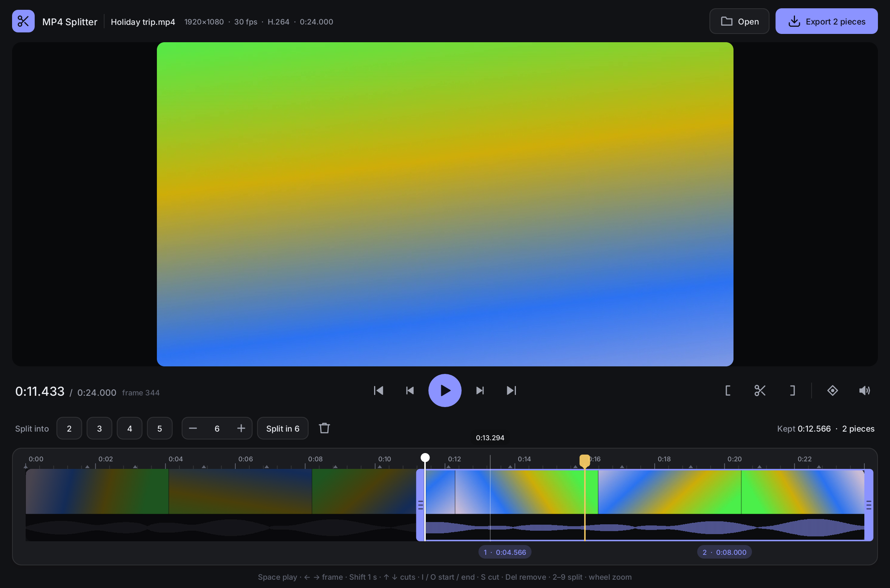
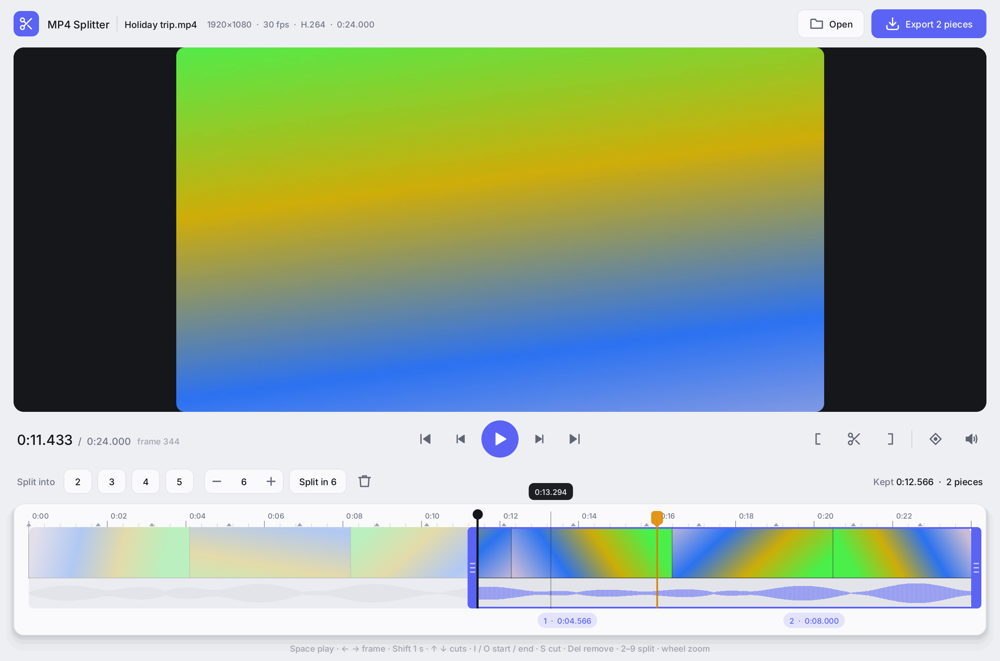

<h1 align="center">PowerNapps MP4 Splitter</h1>

**A tiny, good-looking, cross-platform tool that cuts MP4 videos into pieces
without re-encoding.** Windows, macOS and Linux. Apache-2.0.



## Features

- **Lossless.** Pieces are copied sample by sample from the original, never
  re-encoded, so they keep the original quality and are written in about the
  time it takes to copy the file. Cuts are exact to the frame: each piece
  starts at the key frame before the cut, and an edit list makes it begin
  exactly where you cut (ffmpeg, VLC, browsers and QuickTime honour it).
  Turn on *Snap to key frames* (<kbd>N</kbd>) for pieces that start on a key
  frame for players that ignore edit lists.
- **Trim the start and end** with the handles at both ends of the timeline,
  or <kbd>I</kbd> / <kbd>O</kbd> at the playhead.
- **Cut in the middle**: <kbd>S</kbd> at the playhead, or double-click the
  timeline. Drag a cut to move it; right-click or double-click it to remove it.
- **Remove the gaps**: click a piece's label on the timeline, or press
  <kbd>Delete</kbd> or <kbd>X</kbd> with the playhead inside it, to switch it
  off. Dropped pieces are dimmed and struck through, and playback skips them.
- **Separate files or one file**: export each kept piece to its own file, or
  join them in order into one, still without re-encoding. Each joined piece
  starts at its key frame and an edit list hides the lead-in, so players that
  ignore edit lists (Windows' own) also show those frames; turn on *Snap to key
  frames* first if that matters.
- **Presets**: split the kept part into 2, 3, 4, 5 or any number of equal
  pieces (the buttons, or <kbd>2</kbd>–<kbd>9</kbd>).
- **A timeline like YouTube Studio's**: thumbnails, the sound's waveform, a
  ruler with key-frame marks, and the pieces with their lengths. Zoom with the
  mouse wheel (down to single frames), pan with Shift + wheel or the middle
  button.
- **Playback with sound**, scrubbing with the mouse and frame-exact stepping
  with the keyboard.
- **35 languages**, right to left where they read that way, following your
  system or your choice in Settings. On macOS and Linux, the ones outside the
  built-in font (Arabic, Hebrew, Hindi, Thai, Chinese, Japanese, Korean) wait for
  the OS text stack to be ported there.
- **Dark and light themes** that follow your OS, or your choice in Settings,
  with Rustshot's design tokens, its accent colours and the Inter font. Everything is drawn by the app itself (no GUI
  toolkit, no web view). On Windows it is hand-rolled on the OS's own APIs, like
  Rustshot, and the release build is about 0.8 MB.
- **Updates**: once a day it asks GitHub whether there's a newer release (the
  request says only which app and version is asking; turn it off in Settings).
  The Windows exe checks the new version against the release's `SHA256SUMS.txt`,
  swaps itself and restarts when you say so; a version that won't start is
  swapped back. macOS and Linux open the download page.



## Keys

| Key | Does |
|---|---|
| <kbd>Space</kbd> / <kbd>K</kbd> | Play / pause |
| <kbd>←</kbd> <kbd>→</kbd> (or <kbd>,</kbd> <kbd>.</kbd>, or the wheel over the picture) | Previous / next frame |
| <kbd>Shift</kbd>+<kbd>←</kbd> <kbd>→</kbd>, <kbd>J</kbd> / <kbd>L</kbd> | 1 second back / forward |
| <kbd>Ctrl</kbd>+<kbd>←</kbd> <kbd>→</kbd> | 5 seconds back / forward |
| <kbd>↑</kbd> <kbd>↓</kbd> | Previous / next marker (start, cuts, end) |
| <kbd>PgUp</kbd> <kbd>PgDn</kbd> | Previous / next key frame |
| <kbd>Home</kbd> <kbd>End</kbd> | Start / end of the video |
| <kbd>I</kbd> or <kbd>[</kbd>, <kbd>O</kbd> or <kbd>]</kbd> | Set the start / end at the playhead |
| <kbd>S</kbd> (or <kbd>C</kbd>) | Cut at the playhead |
| <kbd>Delete</kbd> or <kbd>X</kbd> | Remove the cut at the playhead; away from a cut, switch the piece there off or on |
| <kbd>2</kbd>–<kbd>9</kbd>, <kbd>0</kbd> | Split into N equal pieces; remove all cuts |
| <kbd>N</kbd> | Snap to key frames |
| <kbd>M</kbd> | Mute |
| <kbd>+</kbd> <kbd>-</kbd> <kbd>\</kbd> | Zoom in / out / show everything |
| <kbd>Ctrl</kbd>+<kbd>1</kbd> | Window to the video's actual size (or as large as fits) |
| <kbd>Ctrl</kbd>+<kbd>0</kbd> | Fit the window to the video, removing the black bars |
| <kbd>F1</kbd> | About |
| <kbd>Ctrl</kbd>+<kbd>,</kbd> | Settings |
| <kbd>Ctrl</kbd>+<kbd>O</kbd> | Open (or drop a file on the window) |
| <kbd>Ctrl</kbd>+<kbd>E</kbd> | Export next to the video (<kbd>Shift</kbd>+click Export: choose a folder) |

Pieces are saved as `<name>_part01.mp4`, `<name>_part02.mp4`, … (or
`<name>_trimmed.mp4` for one piece), joined ones as `<name>_edited.mp4`, and
never overwrite a file.

## Pictures and sound

Cutting is done by PowerNapps MP4 Splitter itself, on every system. The **pictures and
sound** in the window come from:

- **Windows:** the system. Media Foundation decodes, on the GPU where it can,
  and WASAPI plays. Nothing to install. H.265 needs Microsoft's HEVC extension,
  and Windows "N" editions the Media Feature Pack; without them the app still
  trims and splits, without previews.
- **macOS and Linux:** [ffmpeg](https://ffmpeg.org/download.html), which must be
  installed: `brew install ffmpeg` (macOS), `sudo apt install ffmpeg` (Debian,
  Ubuntu). It is looked for next to the app, on `PATH`, in Homebrew's folders, or
  at `MP4_SPLITTER_FFMPEG`. Without it the app still trims and splits, without
  previews.

## Command line

```
mp4-splitter [VIDEO]                    open the window
mp4-splitter --split 3 VIDEO            three equal pieces, no window
mp4-splitter --cut 12.5,40 VIDEO        cut at 12.5 s and 40 s
     [--start S] [--end E]              keep only S..E (seconds)
     [--drop 2,4]                       leave out these pieces (from 1)
     [--join]                           join what is kept into one file
mp4-splitter --info VIDEO               frames, key frames, size, codecs
```

## Building

Rust 1.88 or newer (edition 2024). Linux also needs the ALSA headers
(`libasound2-dev`) to build and `libxkbcommon-x11-0` to run. On Windows the
Windows SDK's `rc.exe` embeds the icon and version info (without it, the build
works and the exe has no icon).

```
cargo build --release
cargo test        # the tests use ffmpeg to make and check files, on every system
```

The cutting code (`src/mp4.rs`), the renderer and the Windows layers are adapted
from [Rustshot](https://github.com/nappsllc/rustshot). Files must be plain
(not fragmented) MP4, M4V or MOV; fragmented files are refused with a message.

## License

[Apache License 2.0](LICENSE); see [NOTICE](NOTICE). The Inter font is under
the SIL Open Font License 1.1.
